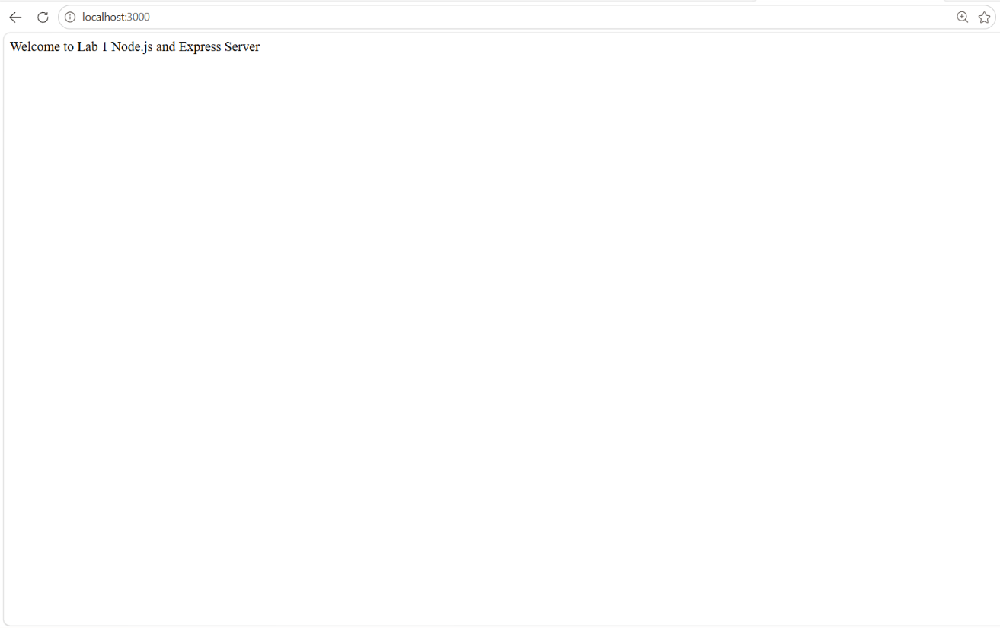
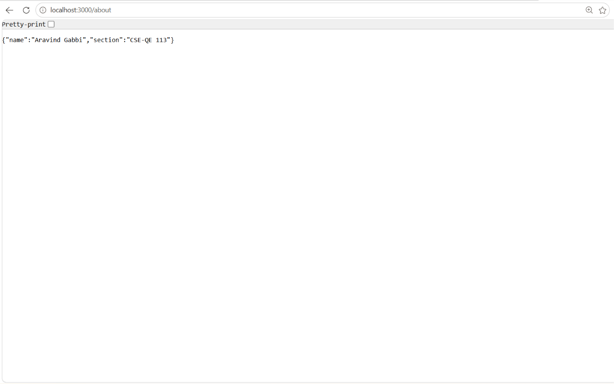
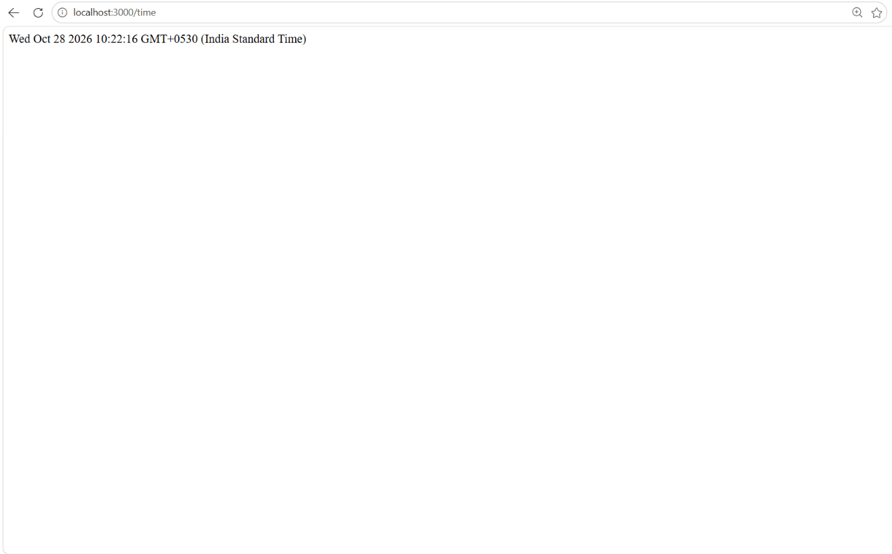
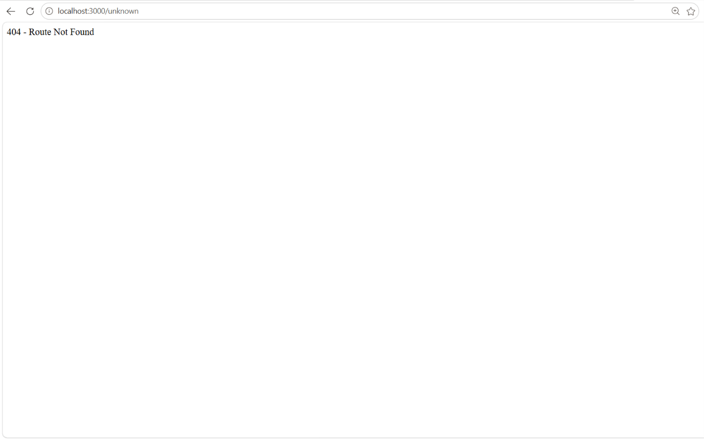

# Lab 1: Node.js and Express server

## Student Details

- **Name:** Aravind Gabbi
- **Registration Number:** [Enter Registration Number]
- **Section:** CSE-QE 113

## Live Link

Not deployed yet

## How to Run

1. Navigate to the `lab-01` directory:
   ```bash
   cd lab-01
   ```

2. Install dependencies:
   ```bash
   npm install
   ```

3. Run the plain Node.js HTTP server (built-in `http` module):
   ```bash
   node server-http.js
   # or
   npm run start:http
   ```

4. Run the Express server:
   ```bash
   node server.js
   # or
   npm start
   ```

The server will be available at `http://localhost:3000`.

## Endpoints

| Method | Path | Description | Expected Status Code |
|---|---|---|---|
| GET | `/` | Returns the welcome message | `200` |
| GET | `/about` | Returns name and section as JSON | `200` |
| GET | `/time` | Returns the current date and time | `200` |
| GET | Any unknown path | Returns a 404 response | `404` |

## Screenshots

### 1. Home Route (`GET /`)


### 2. About Route (`GET /about`)


### 3. Time Route (`GET /time`)


### 4. 404 Route (`GET /unknown`)


## Notes

No major issues encountered. Both the plain Node.js HTTP server (`server-http.js`) and Express server (`server.js`) were initialized, configured, and verified. All routes return the specified status codes (200 for valid routes and 404 for unknown routes).
