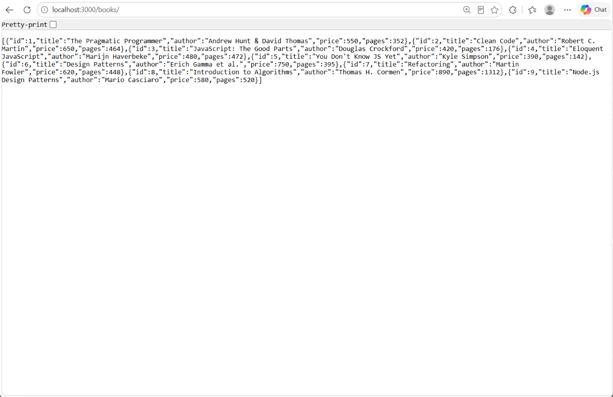
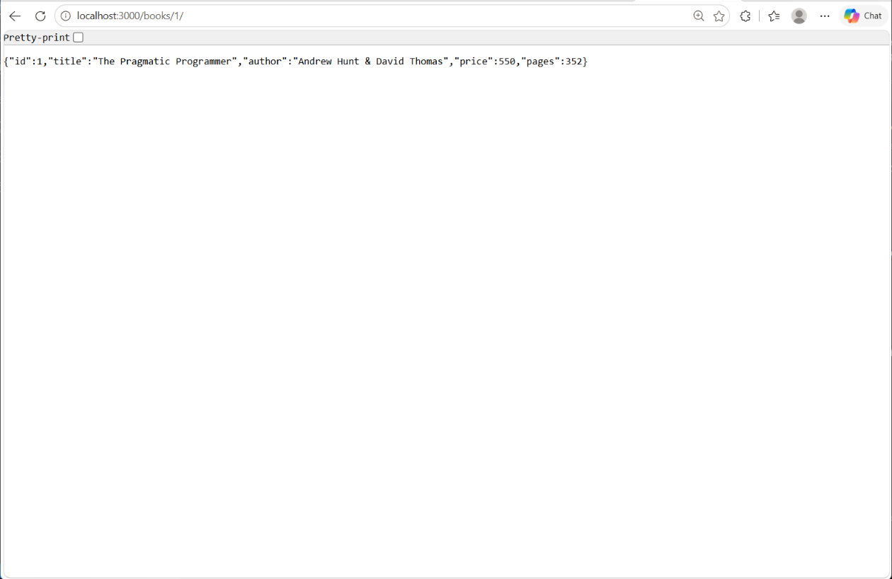
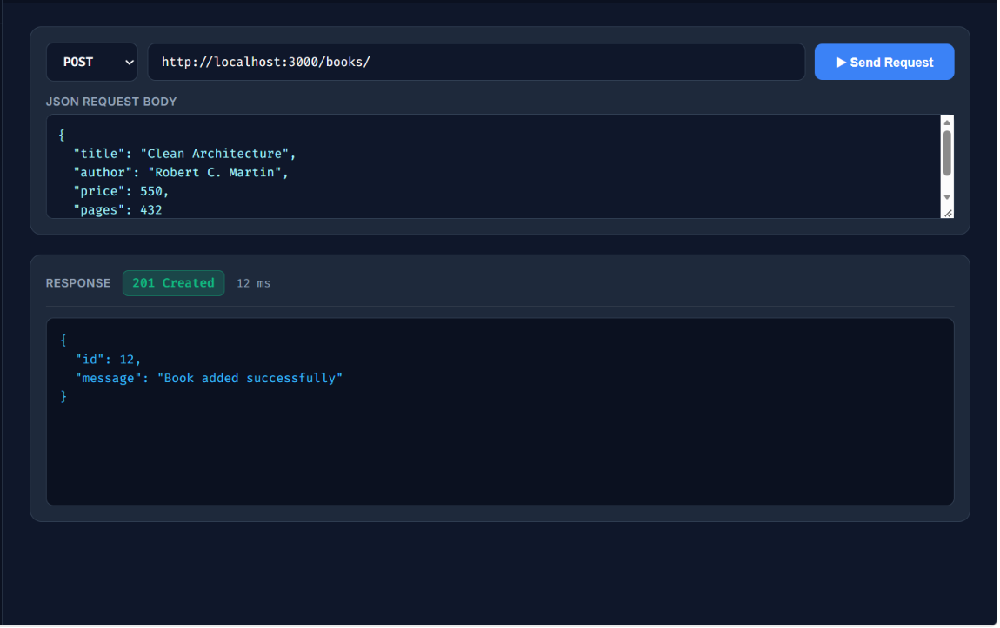
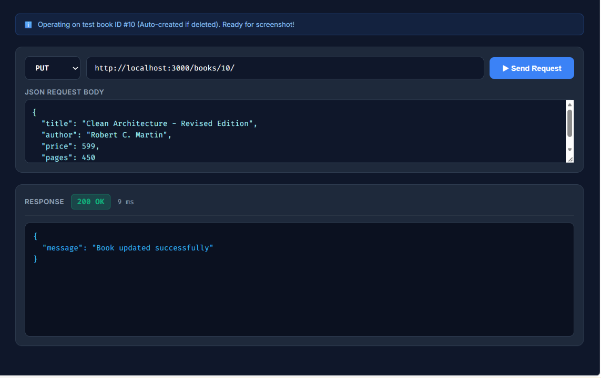
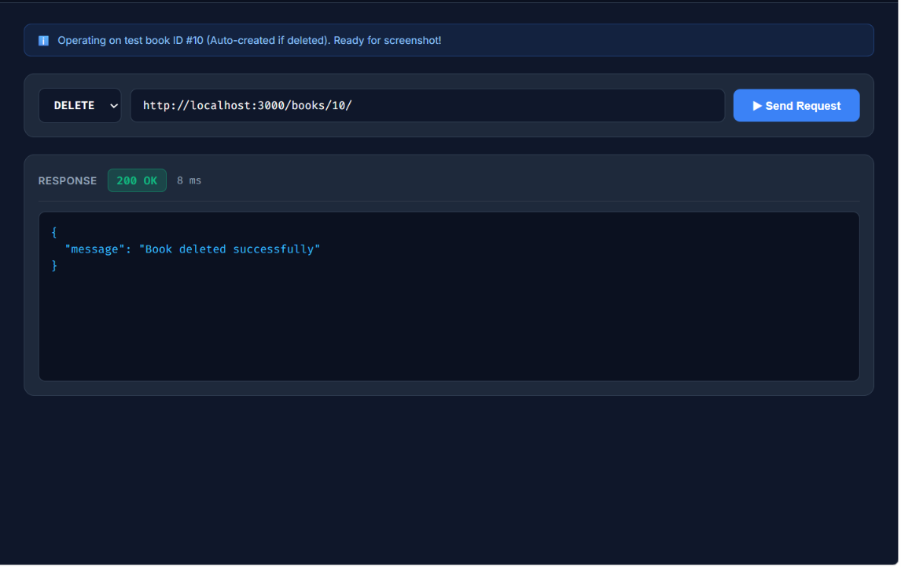
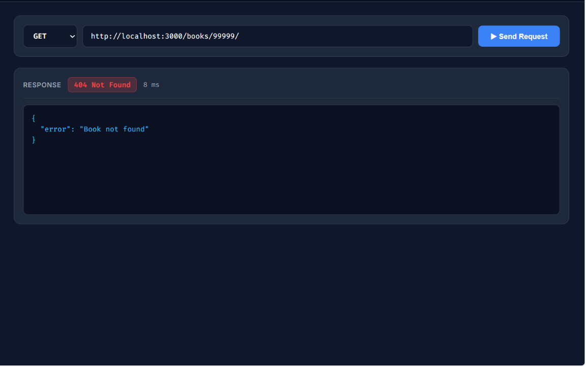
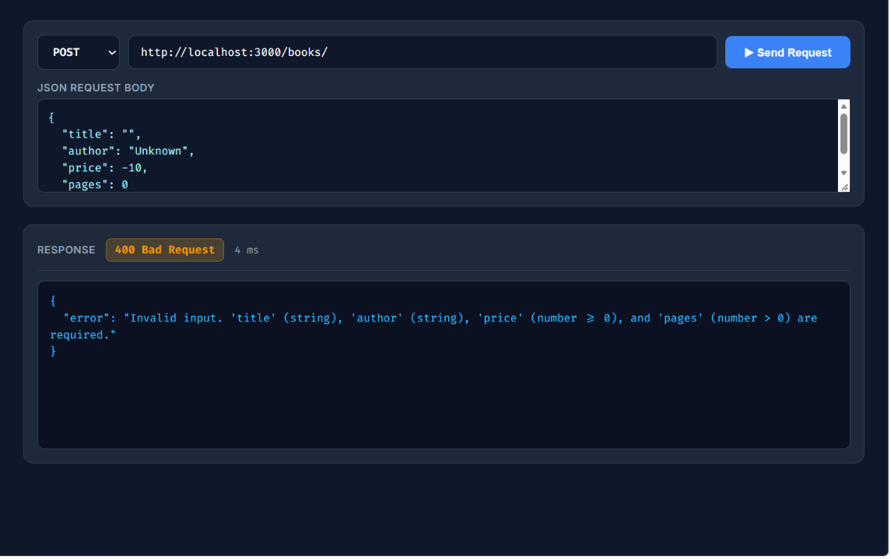
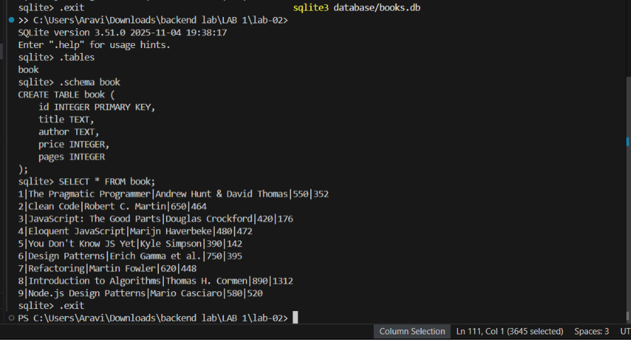

# Lab 2: SQLite database and CRUD routes

## Student Details

- **Name:** Aravind Gabbi
- **Registration Number:** 252U1R8021
- **Section:** CSE-QE 113

## Live Link

[https://lab-02-sqlite-server.onrender.com/](https://lab-02-sqlite-server.onrender.com/)

- **Interactive API Tester Studio:** [https://lab-02-sqlite-server.onrender.com/tester](https://lab-02-sqlite-server.onrender.com/tester)
- **Books API Endpoint:** [https://lab-02-sqlite-server.onrender.com/books/](https://lab-02-sqlite-server.onrender.com/books/)

## Project Description

This project implements a RESTful API for a book management system using Node.js, Express, and SQLite. It provides complete CRUD (Create, Read, Update, Delete) operations with parameterized queries to prevent SQL injection, and starts the Express server only after establishing a verified database connection.

## Requirements

- **Runtime:** Node.js (v18+)
- **Packages:**
  - `express`: Minimalist web framework for Node.js
  - `sqlite`: Promise-based wrapper for SQLite
  - `sqlite3`: Native SQLite3 driver
  - `nodemon` (devDependencies): Development server with hot-reload

## How to Install and Run

1. Navigate to the `lab-02` directory:
   ```bash
   cd lab-02
   ```

2. Install dependencies:
   ```bash
   npm install
   ```

3. Run in development mode (with auto-restart via Nodemon):
   ```bash
   npm run dev
   ```

4. Run in production mode:
   ```bash
   npm start
   ```

*Environment Variables:* None strictly required. The server automatically defaults to port `3000` (or `process.env.PORT` if set).

## Database

- **File Location:** `database/books.db`
- **Setup Script:** `database/init.sql`

### Table Schema (`book`)

| Column | Type | Constraints |
|---|---|---|
| `id` | INTEGER | PRIMARY KEY |
| `title` | TEXT | |
| `author` | TEXT | |
| `price` | INTEGER | |
| `pages` | INTEGER | |

### Inspecting via SQLite CLI

```bash
sqlite3 database/books.db
```

Inside the SQLite prompt:
```sql
.tables
.schema book
SELECT * FROM book;
.exit
```

Initial seed data includes 9 sample books.

## Endpoints

| Method | Path | Description | Expected Status Codes |
|---|---|---|---|
| `GET` | `/books/` | Retrieve all books from the database | `200 OK` |
| `GET` | `/books/:bookId/` | Retrieve a single book by ID | `200 OK`, `404 Not Found`, `400 Bad Request` |
| `POST` | `/books/` | Insert a new book record | `201 Created`, `400 Bad Request` |
| `PUT` | `/books/:bookId/` | Update all editable fields of an existing book | `200 OK`, `404 Not Found`, `400 Bad Request` |
| `DELETE` | `/books/:bookId/` | Delete an existing book by ID | `200 OK`, `404 Not Found`, `400 Bad Request` |
| `ANY` | Unknown path | Catch-all handler for undefined routes | `404 Not Found` |

## Screenshots

### 1. GET All Books (`GET /books/`)


### 2. GET Single Book (`GET /books/1/`)


### 3. POST New Book (`POST /books/`)


### 4. PUT Update Book (`PUT /books/:bookId/`)


### 5. DELETE Book (`DELETE /books/:bookId/`)


### 6. Non-Existent Book 404 (`GET /books/99999/`)


### 7. Invalid Input 400 (`POST /books/`)


### 8. SQLite Database Verification


## Notes

- **Database Connection Synchronization:** Asynchronous `initializeDBAndServer()` guarantees the Express server does not accept incoming HTTP requests before the SQLite database file connection is established.
- **SQL Injection Prevention:** All queries handling user input (`:bookId` and request bodies) strictly use parameterized queries (`?` placeholders).
- **Test Isolation:** Automatic verification tests used disposable records for POST, PUT, and DELETE, leaving all 9 seeded books intact.
