# Lab 3: REST API, Query Parameters, Validation, and Debugging

## Student Details

- **Name:** G. Aravind
- **Registration Number:** 252U1R8021
- **Section:** CSE-QE 113

## Deployment & Live Link Status

- **Live Base URL:** [https://lab-03-rest-api-prko.onrender.com/](https://lab-03-rest-api-prko.onrender.com/)
- **Live Books Endpoint:** [https://lab-03-rest-api-prko.onrender.com/books/](https://lab-03-rest-api-prko.onrender.com/books/)
- **Local Base URL:** `http://localhost:3000/books/`
- **Render Deployment Status:** Active & Deployed on Render (`rootDir: lab-03`, `startCommand: node index.js`, binding to `process.env.PORT || 3000`).  
- **Note on Cloud SQLite Persistence:** SQLite operates on an ephemeral local filesystem on standard free-tier hosting platforms like Render. Any runtime database modifications (such as POST or DELETE) reset upon redeployment or service restart unless backed by persistent disk storage.

---

## How to Install and Run

### 1. Navigate to the `lab-03` directory:
```bash
cd lab-03
```

### 2. Install dependencies:
```bash
npm install
```

### 3. Run in Development Mode (auto-restarts on change via nodemon):
```bash
npm run dev
```

### 4. Run in Production Mode:
```bash
npm start
```

- **Server URL:** `http://localhost:3000/` (or port specified via `process.env.PORT`).
- **Environment Variables:** `PORT` (optional, defaults to `3000`).

---

## Database

- **Database File:** `books.db` (SQLite)
- **Schema & Seed Script:** `setup.sql`

### Table Schema (`book`)

| Column | Type | Constraints | Description |
|---|---|---|---|
| `id` | INTEGER | PRIMARY KEY | Unique identifier for each book record |
| `title` | TEXT | NOT NULL | Title of the book |
| `author` | TEXT | NOT NULL | Author of the book |
| `price` | INTEGER | NOT NULL | Price of the book (in INR) |
| `pages` | INTEGER | NOT NULL | Page count of the book |

### Inspecting via SQLite CLI

```bash
sqlite3 books.db
```

Inside the SQLite prompt:
```sql
.tables
.schema book
SELECT * FROM book;
.exit
```

To re-initialize or reset the database with the original 10 sample records:
```bash
sqlite3 books.db < setup.sql
```

---

## Endpoints

| Method | Path | Description | Query Parameters / Body | Success Status | Error Status |
|:---:|:---|:---|:---|:---:|:---:|
| `GET` | `/books/` | List books with search, sort, filter, and pagination | `search_q`, `order_by`, `order`, `limit`, `offset`, `min_price`, `max_price` | `200 OK` | `400 Bad Request`, `500 Internal Server Error` |
| `GET` | `/books/:bookId/` | Retrieve a single book by ID | Path parameter: `bookId` | `200 OK` | `400 Bad Request`, `404 Not Found` |
| `POST` | `/books/` | Create a new book record | JSON body: `{ "title", "author", "price", "pages" }` | `201 Created` | `400 Bad Request` |
| `PUT` | `/books/:bookId/` | Update all fields of an existing book | JSON body: `{ "title", "author", "price", "pages" }` | `200 OK` | `400 Bad Request`, `404 Not Found` |
| `DELETE` | `/books/:bookId/` | Delete an existing book by ID | Path parameter: `bookId` | `200 OK` | `400 Bad Request`, `404 Not Found` |
| `ANY` | Unknown path | Catch-all handler for undefined routes | None | — | `404 Not Found` |

---

## Query Parameters for `GET /books/`

| Parameter | Type | Default | Validation & Allowed Values | Description |
|---|---|---|---|---|
| `search_q` | String | `""` | Any string | Case-insensitive partial title search using SQL `LIKE ?` with `%search_q%`. |
| `order_by` | String | `"id"` | Strict allowlist: `id`, `title`, `author`, `price`, `pages` | Column to sort by. Rejects unapproved columns with `400 Bad Request`. |
| `order` | String | `"ASC"` | Strict allowlist: `ASC`, `DESC` (case-insensitive) | Sorting order direction. Rejects invalid directions with `400 Bad Request`. |
| `limit` | Integer | `10` | Positive integer (`limit > 0`) | Number of book records to return. Rejects non-numeric or negative values with `400 Bad Request`. |
| `offset` | Integer | `0` | Non-negative integer (`offset >= 0`) | Pagination offset index. Rejects non-numeric or negative values with `400 Bad Request`. |
| `min_price` | Number | — | Non-negative number (`min_price >= 0`) | Filters books with `price >= min_price`. Rejects invalid inputs with `400 Bad Request`. |
| `max_price` | Number | — | Non-negative number (`max_price >= 0`) | Filters books with `price <= max_price`. Rejects invalid inputs with `400 Bad Request`. |

> **Price Range Rule:** When both `min_price` and `max_price` are provided, the API enforces `min_price <= max_price` (using SQL `BETWEEN ? AND ?`). If `min_price > max_price`, it returns `400 Bad Request`.

---

## Request & Response Examples

### 1. `POST /books/` (Create a Book)
**Request:**
```http
POST /books/
Content-Type: application/json

{
  "title": "Sapiens",
  "author": "Yuval Noah Harari",
  "price": 450,
  "pages": 443
}
```
**Response (`201 Created`):**
```json
{
  "message": "Book added successfully",
  "bookId": 11
}
```

### 2. `PUT /books/:bookId/` (Update a Book)
**Request:**
```http
PUT /books/11/
Content-Type: application/json

{
  "title": "Sapiens (Revised Edition)",
  "author": "Yuval Noah Harari",
  "price": 499,
  "pages": 450
}
```
**Response (`200 OK`):**
```json
{
  "message": "Book updated successfully"
}
```

### 3. `DELETE /books/:bookId/` (Delete a Book)
**Request:**
```http
DELETE /books/11/
```
**Response (`200 OK`):**
```json
{
  "message": "Book deleted successfully"
}
```

### 4. Input Validation Failure (`400 Bad Request`)
```json
{
  "message": "Invalid input: title, author, non-negative price, and positive pages are required"
}
```

---

## Screenshots

### 1. GET All Books (Default query)
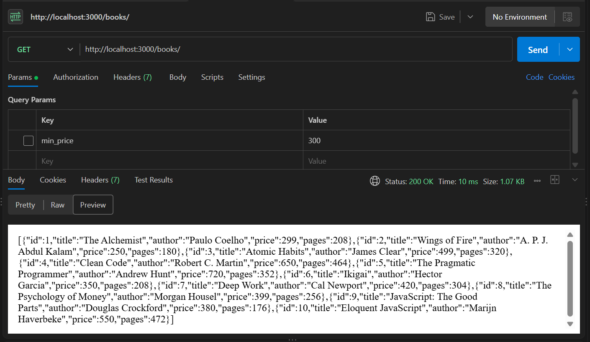

### 2. Search Query Filter (`?search_q=Code`)
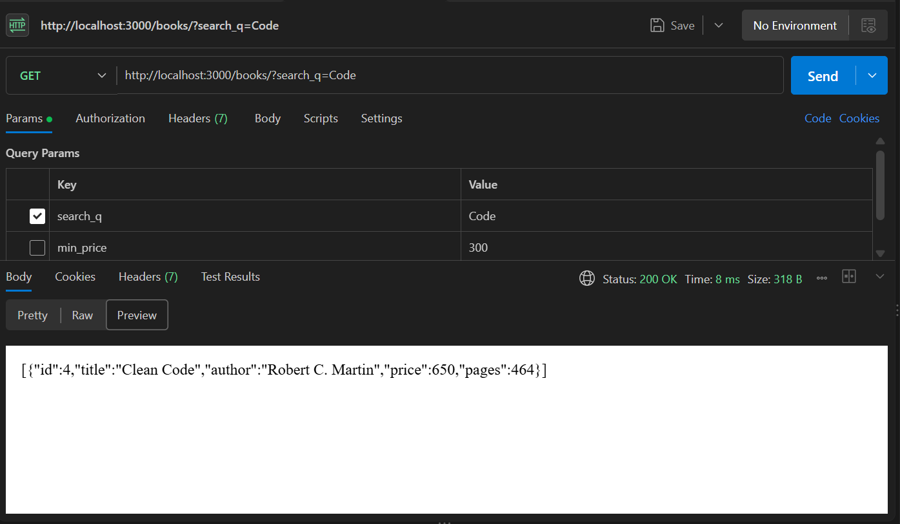

### 3. Price Range Filter (`?min_price=300&max_price=500`)
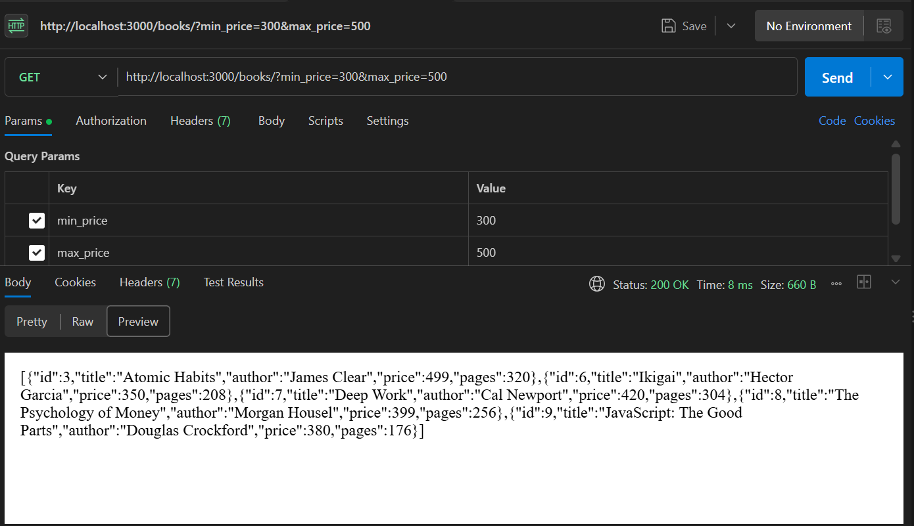

### 4. Sorting Order (`?order_by=price&order=DESC`)
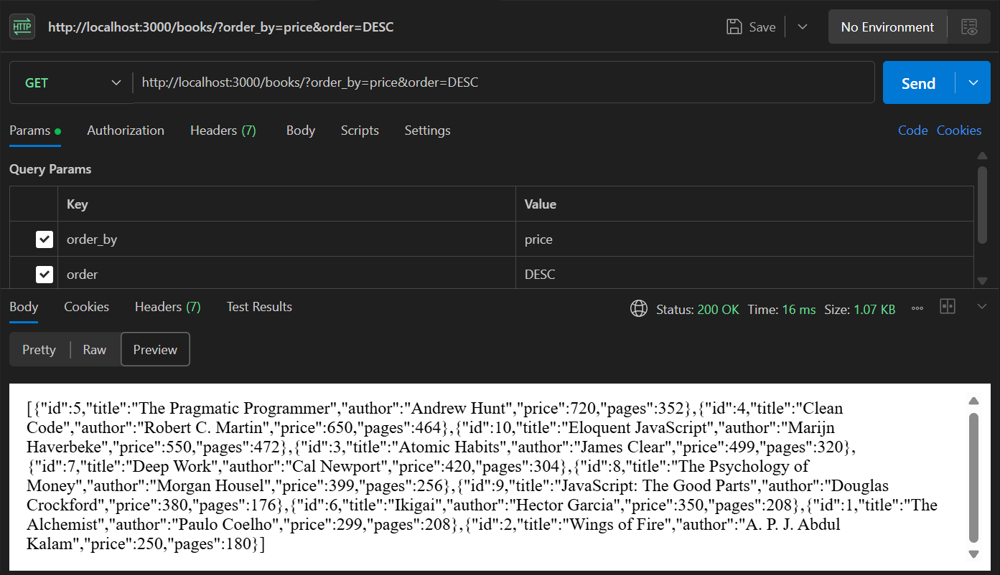

### 5. Pagination (`?limit=3&offset=0`)
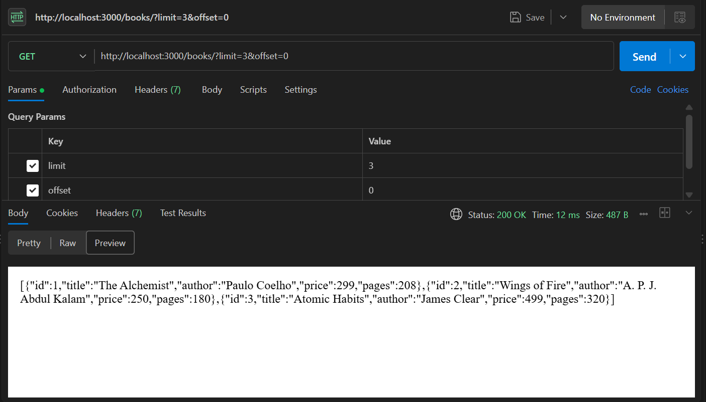

### 6. GET Single Book (`GET /books/3/`)
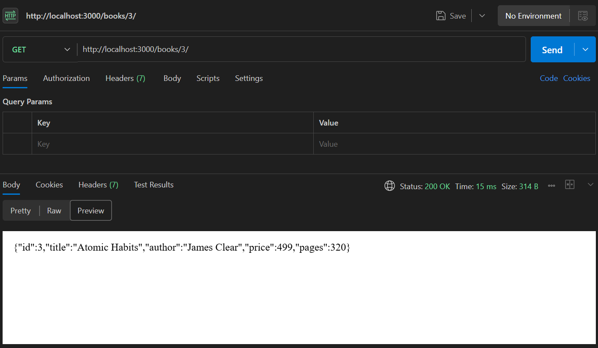

### 7. GET Nonexistent Book (`GET /books/999/` -> `404 Not Found`)
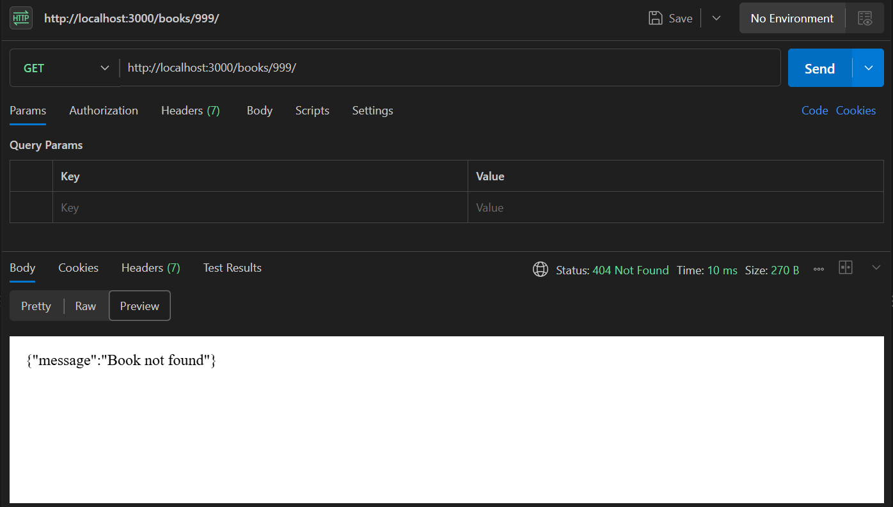

### 8. POST Create Book (`POST /books/` -> `201 Created`)
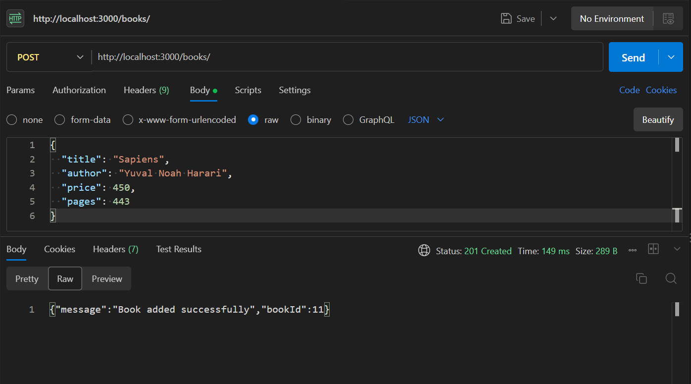

### 9. POST Invalid Body (`POST /books/` -> `400 Bad Request`)
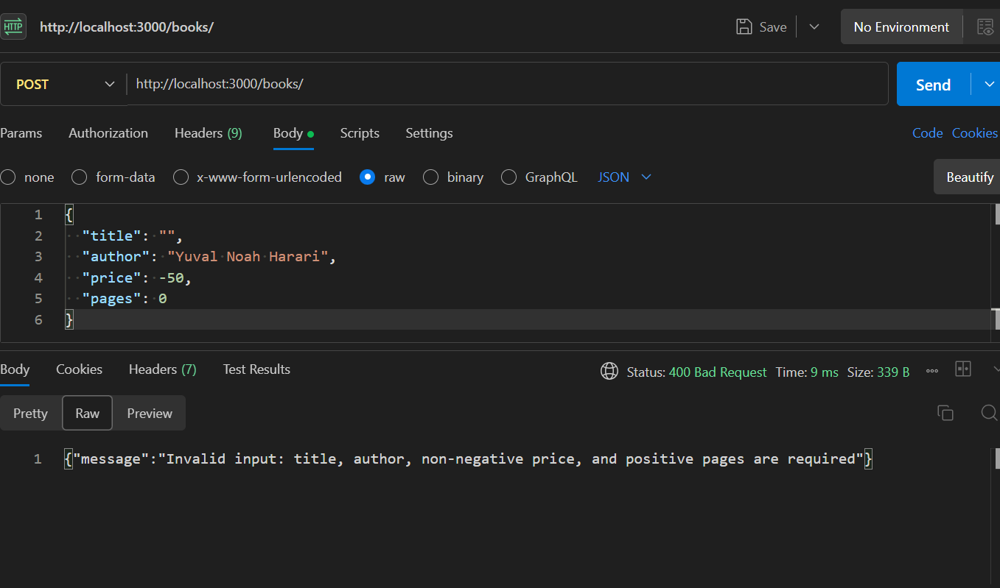

### 10. PUT Update Book (`PUT /books/11/` -> `200 OK`)
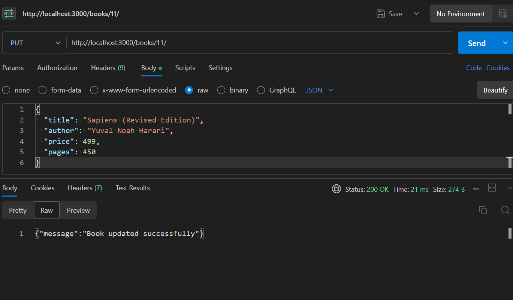

### 11. DELETE Book (`DELETE /books/11/` -> `200 OK`)
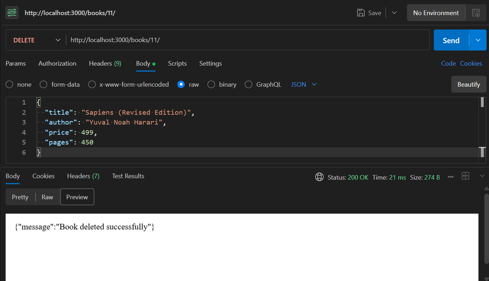

### 12. DELETE Again (`DELETE /books/11/` -> `404 Not Found`)
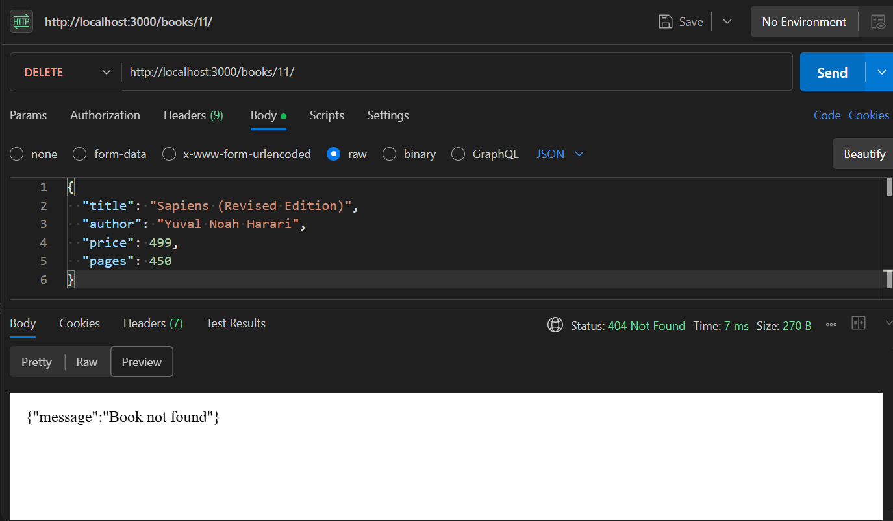

---

## Debugging Exercise: Common Errors & Fixes

1. **Port Conflict (`EADDRINUSE`)**:
   - *Cause:* Another process is already bound and actively listening on port 3000.
   - *Fix:* Stop the conflicting process (`Ctrl+C`), inspect running TCP connections (`Get-NetTCPConnection -LocalPort 3000` in PowerShell or `lsof -i :3000` in Unix), or pass a fallback port via environment variable: `PORT=3001 npm start`.

2. **Wrong Import Path**:
   - *Cause:* Using inaccurate relative module paths (e.g., `require('./database/books')` or resolving `books.db` relative to `process.cwd()` instead of `__dirname`).
   - *Fix:* Use Node's built-in `path.join(__dirname, 'books.db')` to construct deterministic, absolute file paths regardless of the working directory from which the command was invoked.

3. **Table Name Typo (`no such table`)**:
   - *Cause:* Executing SQL statements targeting non-existent or pluralized table names (e.g., `SELECT * FROM books` when the table is created as `book`).
   - *Fix:* Cross-reference table declarations in `setup.sql` or run `.tables` inside the SQLite interactive shell to verify table naming consistency across all queries.

4. **Missing `await`**:
   - *Cause:* Omitting `await` before asynchronous SQLite operations (e.g., `const books = db.all(...)`). The route returns an unresolved Promise object (`{}`) instead of database rows.
   - *Fix:* Ensure every asynchronous database call inside the `async (req, res)` handler is explicitly prefixed with `await`.

---

## Viva Questions & Answers

1. **What is the difference between a query parameter and a path parameter?**
   - **Path parameters** (e.g. `/books/:bookId`) are part of the resource URL path used to identify a specific, individual resource.
   - **Query parameters** (e.g. `/books?order_by=price&limit=5`) appear after the `?` delimiter and are used to filter, sort, search, or paginate a collection without altering the core resource identity.

2. **What does "stateless" mean in REST architecture?**
   - Statelessness means the server does **not** retain any client session state between requests. Every single incoming request must include all information, headers, parameters, and credentials required for the server to process it completely and independently.

3. **Which HTTP status code should be returned for bad input versus a missing record?**
   - **`400 Bad Request`**: Returned when the client sends malformed input, invalid parameters, missing required fields, or unparseable JSON.
   - **`404 Not Found`**: Returned when the requested URL endpoint or database resource ID does not exist.

4. **Why can't SQL query placeholders (`?`) be used for `ORDER BY` column names or directions?**
   - SQL parameterized placeholders (`?`) can only represent scalar data literals (strings, numbers, booleans) to prevent data injection. Database engines do not allow identifiers (column names, table names, or SQL keywords like `ASC`/`DESC`) to be parameterized.
   - Therefore, sorting columns and directions must be validated against a strict, predefined allowlist (`allowedColumns.includes(...)`) before interpolating them into SQL clauses.

5. **How does SQLite storage behave on cloud platforms like Render?**
   - Render web services on free tiers run on ephemeral containers. While the committed SQLite database (`books.db`) is deployed and accessible, any new rows inserted or modified during runtime exist only in the temporary container instance. When the container restarts or redeploys, modifications are lost unless backed by persistent disk storage.

---

## Technical Notes

- **Database Connection Precedence:** `initializeDBAndServer()` establishes a verified database connection prior to calling `app.listen()`, preventing the server from accepting incoming HTTP requests when the database is unavailable.
- **Strict Parameterization:** All client-provided search terms, price boundaries, limit, offset, and book fields use `?` placeholders in prepared SQL queries, eliminating SQL injection vectors.
- **Automated Verification:** The project includes an automated test harness validating all 40 requirements across all CRUD operations while preserving initial seed data.
